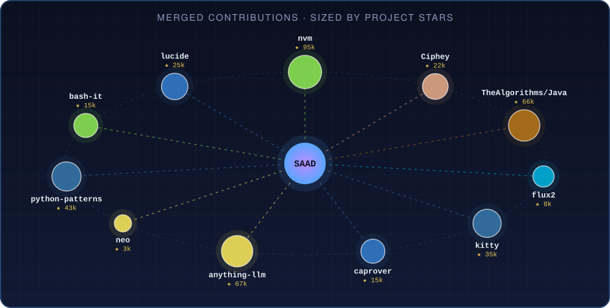

**Full-stack engineer · Lahore, Pakistan (UTC+5)**

I find real bugs in tools developers use every day, fix them, and send the PR.

## 🏆 Merged into projects you probably use

Eleven fixes merged in October 2026, into projects with **~396,000 stars combined**. Where the project has a test suite, the fix came with a regression test.

| Project | ★ | Lang | What I fixed | PR |
|---|---:|---|---|---|
| [**nvm-sh/nvm**](https://github.com/nvm-sh/nvm) | 95k | Shell | `nvm use` broke when `$NVM_DIR` contained regex-special characters | [#3939](https://github.com/nvm-sh/nvm/pull/3939) |
| [**Mintplex-Labs/anything-llm**](https://github.com/Mintplex-Labs/anything-llm) | 67k | JavaScript | Repo provider check used `response.text` instead of `response.send` | [#6677](https://github.com/Mintplex-Labs/anything-llm/pull/6677) |
| [**TheAlgorithms/Java**](https://github.com/TheAlgorithms/Java) | 66k | Java | Out-of-bounds access in `HowManyTimesRotated` on small or unrotated arrays | [#7626](https://github.com/TheAlgorithms/Java/pull/7626) |
| [**faif/python-patterns**](https://github.com/faif/python-patterns) | 43k | Python | `KeyError` in BFS graph search when a node has no outgoing edges | [#506](https://github.com/faif/python-patterns/pull/506) |
| [**kovidgoyal/kitty**](https://github.com/kovidgoyal/kitty) | 35k | Python | `devenv` now escapes spaces when relocating pkg-config prefixes | [#10589](https://github.com/kovidgoyal/kitty/pull/10589) |
| [**lucide-icons/lucide**](https://github.com/lucide-icons/lucide) | 25k | TypeScript | `buildLucideSvg` now escapes attribute values | [#4940](https://github.com/lucide-icons/lucide/pull/4940) |
| [**bee-san/Ciphey**](https://github.com/bee-san/Ciphey) | 22k | Rust | Rail-fence cipher sized its zigzag by bytes instead of characters | [#1037](https://github.com/bee-san/Ciphey/pull/1037) |
| [**Bash-it/bash-it**](https://github.com/Bash-it/bash-it) | 15k | Shell | Syntax error in alias completion when an alias contains a single quote | [#2407](https://github.com/Bash-it/bash-it/pull/2407) |
| [**caprover/caprover**](https://github.com/caprover/caprover) | 15k | TypeScript | Backups preserve dangling symlinks when copying data on macOS | [#2511](https://github.com/caprover/caprover/pull/2511) |
| [**fluxcd/flux2**](https://github.com/fluxcd/flux2) | 8k | Go | Plugin archive entries with a leading `./` are now matched | [#6099](https://github.com/fluxcd/flux2/pull/6099) |
| [**neomjs/neo**](https://github.com/neomjs/neo) | 3k | JavaScript | A form field keeps its own `margin-bottom` regardless of stylesheet load order | [#19412](https://github.com/neomjs/neo/pull/19412) |

Star counts as of 14 Oct 2026, rounded.

## 🧭 What I look for

- **Edge cases that crash or corrupt**: off-by-one reads, empty inputs, uninitialized values, wrong units (bytes vs characters).
- **Quoting, escaping and encoding**: shell quoting, URL encoding, SVG attributes, regex-special paths.
- **Honest errors**: a clear message instead of a panic or a silent wrong answer.
- **Flaky or leaky tests**: tests that pass or fail for the wrong reason.

My PRs follow each project's own rules: its commit style, its test and lint commands, and its contributing and AI-use policies.

## 🛠️ What I build with

- **Day job:** full-stack engineer at Dubizzle Labs, working on CRM platforms for the UAE and Pakistan (Node.js, Express, MySQL, Next.js, React Native).
- **AI work:** RAG pipelines with self-critique, prompt-injection defenses, LLM evaluation, MCP servers.
- **Also:** a small macOS menu-bar clipboard app, [stackpad](https://github.com/Saadanjum0/stackpad) (Swift).

## 🤝 Open to

Remote full-stack and AI-engineering roles, and to maintainers who want a careful bug-fixer. If you maintain a project and have a confirmed bug nobody has picked up, open an issue on one of my PRs or tag me.

I use AI coding tools (Claude Code) as part of my workflow, and I follow each project's AI-contribution policy and disclose where it asks. Numbers above are from the GitHub API on 14 Oct 2026.
