  

  I fix real bugs in tools people use every day. If you maintain one and have a confirmed bug nobody has picked up, <a href="mailto:saadanjum239@gmail.com">tell me</a>.

The pull requests

- nvm-sh/nvm [#3939](https://github.com/nvm-sh/nvm/pull/3939) · Mintplex-Labs/anything-llm [#6677](https://github.com/Mintplex-Labs/anything-llm/pull/6677) · TheAlgorithms/Java [#7626](https://github.com/TheAlgorithms/Java/pull/7626) · faif/python-patterns [#506](https://github.com/faif/python-patterns/pull/506) · kovidgoyal/kitty [#10589](https://github.com/kovidgoyal/kitty/pull/10589) · lucide-icons/lucide [#4940](https://github.com/lucide-icons/lucide/pull/4940) · bee-san/Ciphey [#1037](https://github.com/bee-san/Ciphey/pull/1037) · Bash-it/bash-it [#2407](https://github.com/Bash-it/bash-it/pull/2407) · caprover/caprover [#2511](https://github.com/caprover/caprover/pull/2511) · fluxcd/flux2 [#6099](https://github.com/fluxcd/flux2/pull/6099) · neomjs/neo [#19412](https://github.com/neomjs/neo/pull/19412)
- [LinkedIn](https://www.linkedin.com/in/saadanjum36)

