### Muhammad Saad Anjum

Full-stack engineer in Lahore (UTC+5). I find real bugs in tools people use every day, reproduce them, fix them, and get the fix merged.

[LinkedIn](https://www.linkedin.com/in/saadanjum36) · [saadanjum239@gmail.com](mailto:saadanjum239@gmail.com)

Links to each pull request

 

| Project | Fix | PR |
|---|---|---|
| nvm-sh/nvm | `nvm use` with regex-special characters in `$NVM_DIR` | [#3939](https://github.com/nvm-sh/nvm/pull/3939) |
| Mintplex-Labs/anything-llm | Wrong Express response method in repo provider check | [#6677](https://github.com/Mintplex-Labs/anything-llm/pull/6677) |
| TheAlgorithms/Java | Out-of-bounds read in `HowManyTimesRotated` | [#7626](https://github.com/TheAlgorithms/Java/pull/7626) |
| faif/python-patterns | `KeyError` in BFS on nodes without outgoing edges | [#506](https://github.com/faif/python-patterns/pull/506) |
| kovidgoyal/kitty | Escape spaces when relocating pkg-config prefixes | [#10589](https://github.com/kovidgoyal/kitty/pull/10589) |
| lucide-icons/lucide | Escape attribute values in `buildLucideSvg` | [#4940](https://github.com/lucide-icons/lucide/pull/4940) |
| bee-san/Ciphey | Rail-fence zigzag sized by characters, not bytes | [#1037](https://github.com/bee-san/Ciphey/pull/1037) |
| Bash-it/bash-it | Alias completion with a single quote in the alias | [#2407](https://github.com/Bash-it/bash-it/pull/2407) |
| caprover/caprover | Preserve dangling symlinks in backups on macOS | [#2511](https://github.com/caprover/caprover/pull/2511) |
| fluxcd/flux2 | Match plugin archive entries with a leading `./` | [#6099](https://github.com/fluxcd/flux2/pull/6099) |
| neomjs/neo | Keep a form field's `margin-bottom` across stylesheet load order | [#19412](https://github.com/neomjs/neo/pull/19412) |

Star counts as of 14 Oct 2026. I use AI coding tools as part of my workflow and follow each project's contribution and disclosure policy.
